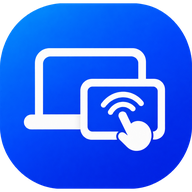

<p align="center">
  
</p>

<h1 align="center">Input_Control</h1>

<p align="center">
  <strong>Turn your Android tablet into a touchpad and keyboard for your Windows PC.</strong><br>
  Move the pointer, type in English or Korean, open pinned apps, and control media from the same screen.
</p>

<p align="center">
  
  
  
</p>

<p align="center">
  <sub>Developed by M. Chung · Sign in to GitHub with access to this repository to download.</sub>
</p>

<p align="center">
  <a href="#touchpad-and-keyboard">Touchpad &amp; keyboard</a> ·
  <a href="#launcher-and-media">Launcher &amp; media</a> ·
  <a href="#download-and-install">Download &amp; install</a> ·
  <a href="#troubleshooting">Troubleshooting</a>
</p>

<br>

<p align="center">
  
</p>

*The Control screen in Modern Light, with the Korean keyboard open. The launcher and media panel stay in place when you switch to the touchpad.*

## Project overview

Input_Control runs as two native applications. The Android controller uses Kotlin and Jetpack Compose with a Rust input engine. The Windows companion uses Rust and native C++/Win32. The tablet sends input and media commands over an encrypted, mutually authenticated connection on the local IPv4 network. The Windows companion applies the commands to the signed-in desktop. [Architecture details](docs/ARCHITECTURE.md)

## Touchpad and keyboard

- **Touchpad.** Move the pointer with one finger, tap to click, scroll with two fingers, or double-tap and drag. Adjust gesture mappings and sensitivity in Settings.
- **English and Korean.** Switch between QWERTY and Korean 두벌식 with **한/영**. Symbols, a number pad, and F1–F12 are available from the keyboard.
- **Automatic switching.** The tablet can open its keyboard when you focus a supported Windows text field. You can also switch modes from the Control header.

## Launcher and media

- **PC app launcher.** Pin up to five Windows apps and tap a tile to open or activate it. Save shortcut profiles for the apps you use.
- **Playback and sound.** Use play/pause, previous, and next with compatible Windows players. See the active media session and adjust the PC’s default output volume or mute state.
- **Appearance.** Pick a theme and toggle scenery in [Themes & Appearance](docs/screenshots/themes/appearance.png).

## Download and install

Use the assets attached to the relevant release. The existing 1.5.0 release uses the older standalone filenames. Version 1.5.1 introduces the installer and portable ZIP through the signed release workflow. [GitHub Releases](https://github.com/minsmakes/Input_Control/releases) · [Published 1.5.0](https://github.com/minsmakes/Input_Control/releases/tag/v1.5.0)

### System requirements

- **Windows 11 x64** with a regular signed-in desktop session. The new packages include the C/C++ runtime in the receiver executable and need no separate device driver. The legacy 1.5.0 EXE may require the [Microsoft Visual C++ x64 Redistributable](https://aka.ms/vc14/vc_redist.x64.exe).
- **Android 9 or later**, ARM64 or x86-64. The interface is designed for tablets.
- Both devices must be on the same trusted IPv4 subnet. The PC can use Ethernet if it shares the tablet's LAN.

### Windows

1. Download the versioned `-windows-x64-setup.exe` and verify its signature and checksum.
2. Run Setup as your regular Windows user. It installs under your user profile and creates a Start Menu shortcut. Select the desktop shortcut if desired.
3. Open **Input_Control** from the Start Menu. The companion shows its listening address. To uninstall, use **Settings → Apps → Installed apps → Input_Control → Uninstall**.

For portable use, verify and extract the entire `-windows-x64-portable.zip` to a folder you control, then run `input-control-receiver.exe`. Pairing and preferences are stored in your Windows account. The installer and portable EXE can both be subject to SmartScreen reputation checks. [Microsoft SmartScreen guidance](https://learn.microsoft.com/windows/apps/package-and-deploy/smartscreen-reputation)

### Android

1. On GitHub Releases, download the signed `-android.apk` and verify it against the release checksum. The `.aab` is for Google Play uploads.
2. Open the downloaded APK from **Chrome → Downloads** or **My Files → Downloads**. If Android prompts for **Install unknown apps**, the permission applies to the app opening the APK. Follow device and organization policy. You can revoke the source permission afterward.
3. Open **Input_Control** once installed. Samsung Auto Blocker can block installation or updates from GitHub even with a correctly signed APK. Play Protect may independently scan, warn, or block. If your device blocks sideloads, use an authorized store track when available. Google Play distribution is planned. [Samsung Auto Blocker](https://www.samsung.com/us/support/answer/ANS10003636/) · [Google Play Protect](https://support.google.com/android/answer/2812853)

## Connecting devices

1. Launch the Windows companion on the same trusted LAN as the tablet.
2. On Android, open **⋮ → Devices → Pair New Device**, choose the PC and tap **Pair**. If discovery fails, tap **Manual connection** and enter the companion's IPv4 address and port **47831**.
3. Compare the three groups shown on Android with the first three groups on the PC. If they match, enter the PC's fourth group on the tablet, tap **Confirm match**, then click **Approve** on the PC within 60 seconds. Reject any mismatch.
4. Open **Control** when the tablet says **Connected**. Try moving the pointer and typing in an ordinary Notepad window. For later sessions, use **Connect** on the saved device and **Disconnect** when finished. Use **Quit** in the Windows notification area to stop the receiver. [Connection and troubleshooting details](docs/DEVICE_CONNECTION.md)

## Troubleshooting

- **The PC doesn’t appear.** Check that the companion is listening and that both devices are on the same subnet. On Android, use **Devices → Manual connection**, enter the PC’s IPv4 address and port **47831**, then tap **Continue**. The same pairing checks apply.
- **The connection times out.** On a trusted network, check that Windows Firewall allows the companion on the Private profile for TCP 47831. Discovery also uses UDP 5353. If Android offers **Allow nearby devices**, grant it and try again.
- **Android won’t update a debug install.** If the existing app was signed with a different key, uninstall it before installing this APK. This clears the saved pairing, so pair again.
- **The pointer moves, but a window ignores keys.** Try a regular Notepad window. Windows may block injected input into elevated windows.
- **The downloads return a 404.** This repository is private. Sign in with a GitHub account that has access.

## Updating

- **Windows Setup.** Quit the receiver from the tray, verify the newer installer, and run it over the existing installation. It keeps pairing data and preferences. If you used a standalone EXE or portable ZIP, quit that copy before launching the installed version. If **Start at Windows sign-in** pointed to the old copy, toggle it off and back on in the new companion.
- **Windows portable.** Quit the receiver and extract the new ZIP. Run the new EXE from the same folder if you use a shortcut or sign-in entry.
- **Android.** Install the newer release APK over the existing production install. Android requires the same package and signing identity. Moving from a debug-signed build requires removing the debug install first, which clears its local data and requires pairing again.

## Security

Download from this project's GitHub Releases. Compare your downloaded file digest with the same filename in the release's `SHA256SUMS.txt`. In PowerShell, run `Get-FileHash -Algorithm SHA256 -LiteralPath <downloaded-file>`. On Windows, check **Properties → Digital Signatures** or run `Get-AuthenticodeSignature -LiteralPath <downloaded-exe>` and confirm a valid signature from the publisher named in the release notes. Signature and signer verification for Android are covered in the [signing guide](docs/RELEASE_AND_SIGNING.md). The legacy v1.5.0 Windows EXE is unsigned.

## Developer guide

Build the Windows companion from the repository root with Rust/MSVC and the Windows SDK installed.

```powershell
cargo test --locked --manifest-path windows-receiver/Cargo.toml
$env:CARGO_TARGET_X86_64_PC_WINDOWS_MSVC_RUSTFLAGS = '-C target-feature=+crt-static'
cargo build --locked --release --target x86_64-pc-windows-msvc --manifest-path windows-receiver/Cargo.toml
Remove-Item Env:CARGO_TARGET_X86_64_PC_WINDOWS_MSVC_RUSTFLAGS
cargo test --locked --manifest-path rust-core/Cargo.toml
cargo test --locked --manifest-path wifi-protocol/Cargo.toml
```

Open `android-app` in Android Studio with JDK 25, Android SDK 37.0, build-tools 36.0.0 and NDK 27.3.13750724. From that directory, run `rustup target add aarch64-linux-android x86_64-linux-android`, then `./gradlew.bat :app:assembleDebug :app:lintRelease` on Windows or `bash ./gradlew :app:assembleDebug :app:lintRelease` on Linux. Run `:app:connectedDebugAndroidTest` on a dedicated emulator or Android test device with the debug-compatible app identity. [Release and signing](docs/RELEASE_AND_SIGNING.md) · [Release checklist](docs/RELEASE_CHECKLIST.md)
