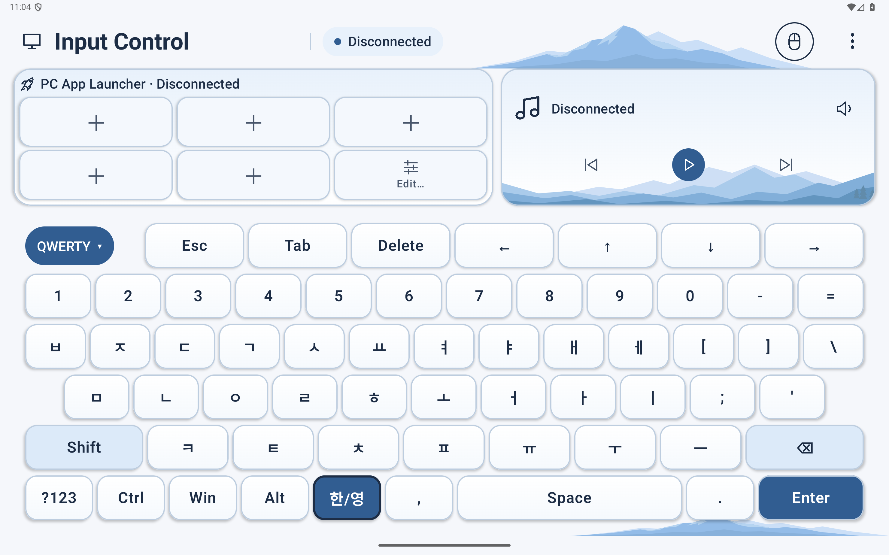

  

<h1 align="center">Input Control</h1>

  <strong>Turn your Android tablet into a touchpad and keyboard for your Windows PC.</strong> 
  Move the pointer, type in English or Korean, open pinned apps, and control media from the same screen.

   &nbsp;
  

  
  
  

  Version 1.5.0 · Sign in to GitHub with access to this repository to download.

  <a href="#touchpad-and-keyboard">Touchpad &amp; keyboard</a> ·
  <a href="#launcher-and-media">Launcher &amp; media</a> ·
  <a href="#install-and-pair">Install &amp; pair</a> ·
  <a href="#troubleshooting">Troubleshooting</a>

 

  

*The Control screen in Modern Light, with the Korean keyboard open. The launcher and media panel stay in place when you switch to the touchpad.*

## Touchpad and keyboard

- **Touchpad.** Move the pointer with one finger, tap to click, scroll with two fingers, or double-tap and drag. Adjust gesture mappings and sensitivity in Settings.
- **English and Korean.** Switch between QWERTY and Korean 두벌식 with **한/영**. Symbols, a number pad, and F1–F12 are available from the keyboard.
- **Automatic switching.** The tablet can open its keyboard when you focus a supported Windows text field. You can also switch modes from the Control header.

## Launcher and media

- **PC app launcher.** Pin up to five Windows apps and tap a tile to open or activate it. Save shortcut profiles for the apps you use.
- **Playback and sound.** Use play/pause, previous, and next with compatible Windows players. See the active media session and adjust the PC’s default output volume or mute state.
- **Appearance.** Pick a theme and toggle scenery in [Themes & Appearance](docs/screenshots/themes/appearance.png).

## Install and pair

1. **Android.** Download and open [input-control.apk](https://github.com/minsmakes/Input_Control/releases/download/v1.5.0/input-control.apk). If prompted, allow your browser or file manager to install the APK. Use Android 9 or newer on ARM64 or x86-64. The app is designed for tablets, and phone layouts still need testing.
2. **Windows.** Download and run [input-control-receiver.exe](https://github.com/minsmakes/Input_Control/releases/download/v1.5.0/input-control-receiver.exe) on Windows 11 x64. The companion window shows the PC name and listening address. If Windows reports missing Visual C++ DLLs, install the [Microsoft Visual C++ x64 Redistributable](https://aka.ms/vc14/vc_redist.x64.exe).
3. Put both devices on the same trusted IPv4 network. Open **⋮ → Devices → Pair New Device** on Android, find your PC, and tap **Pair**.
4. Compare the three groups on Android with the first three on the PC. If they match, enter the PC’s fourth group on Android and tap **Confirm match**, then click **Approve** on the PC within 60 seconds. If the codes differ, reject the request and check that you selected the right PC.
5. When Android says **Connected**, open **Control** and try moving the pointer or typing into Notepad. Use **Connect** for later sessions and **Disconnect** when finished. To stop the Windows companion, choose **Quit** from its notification-area icon.

## Troubleshooting

- **The PC doesn’t appear.** Check that the companion is listening and that both devices are on the same subnet. On Android, use **Devices → Manual connection**, enter the PC’s IPv4 address and port **47831**, then tap **Continue**. The same pairing checks apply.
- **The connection times out.** On a trusted network, check that Windows Firewall allows the companion on the Private profile for TCP 47831. Discovery also uses UDP 5353. If Android offers **Allow nearby devices**, grant it and try again.
- **Android won’t update a debug install.** If the existing app was signed with a different key, uninstall it before installing this APK. This clears the saved pairing, so pair again.
- **The pointer moves, but a window ignores keys.** Try a regular Notepad window. Windows may block injected input into elevated windows.
- **The downloads return a 404.** This repository is private. Sign in with a GitHub account that has access.

[Release notes and files](https://github.com/minsmakes/Input_Control/releases/tag/v1.5.0)
